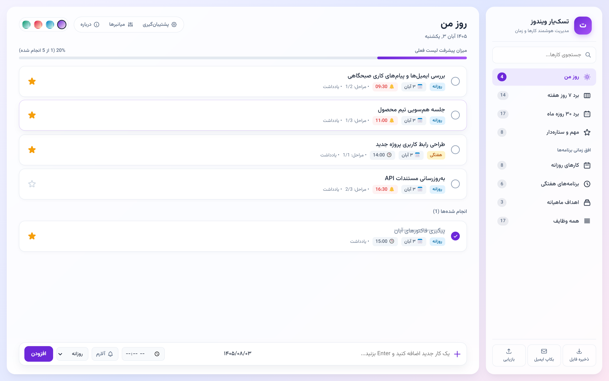
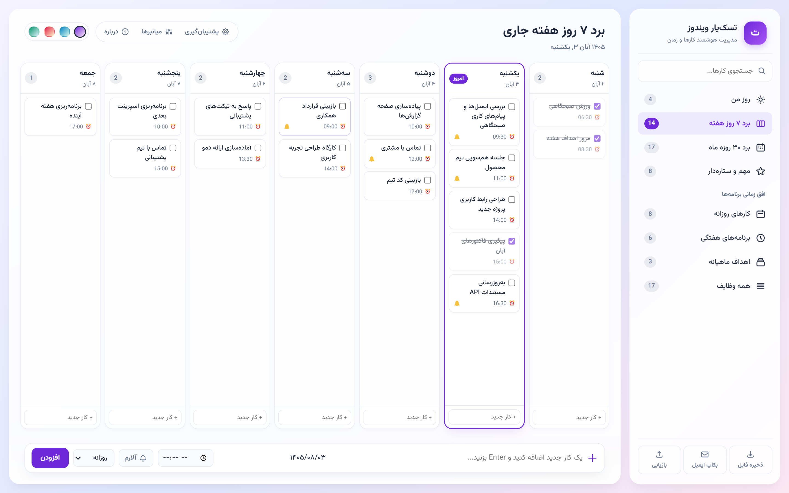
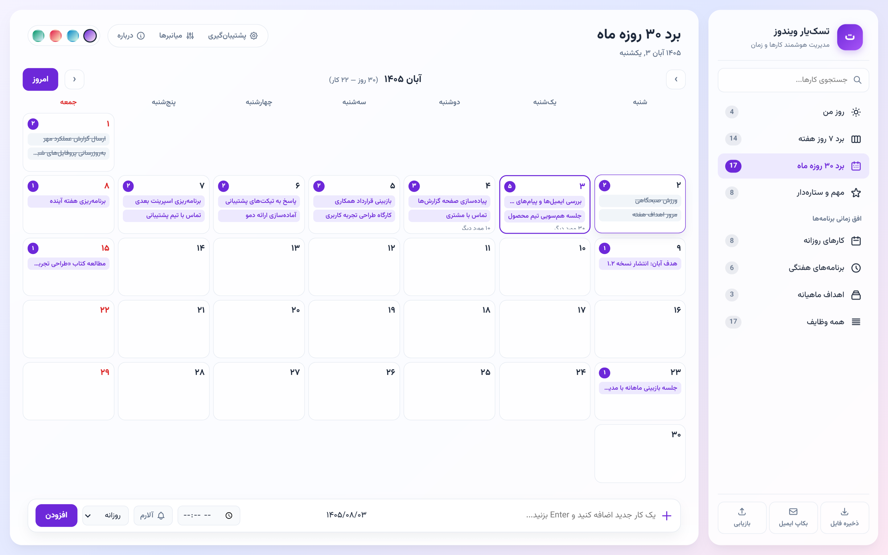
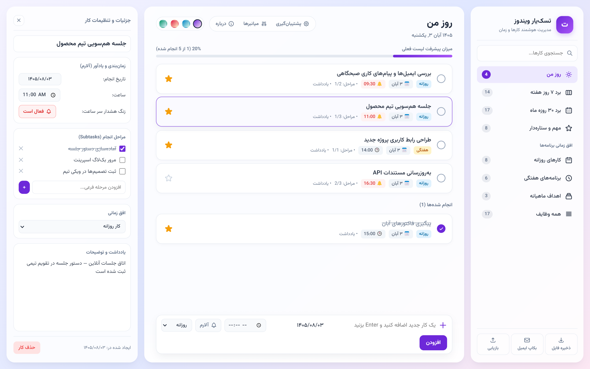
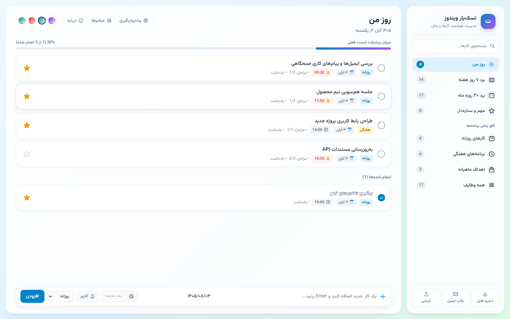

<div align="center" dir="rtl">


# تسک‌یار (TaskYar)

**مدیریت هوشمند کارها و زمان برای ویندوز، با پشتیبانی کامل از تقویم شمسی**

[](https://github.com/mnabishahzamani/taskyar/releases)
[](#install)
[](https://www.electronjs.org)
[](LICENSE)
[](#about)

**[دانلود آخرین نسخه](https://github.com/mnabishahzamani/taskyar/releases/latest)** ·
[امکانات](#features) ·
[تصاویر](#screenshots) ·
[اجرا از سورس](#source) ·
[میانبرها](#shortcuts)


</div>

<div dir="rtl">

<a id="about"></a>

## تسک‌یار چیست؟

تسک‌یار یک برنامه‌ی رومیزی سبک و کاملاً فارسی برای برنامه‌ریزی کارها است که حول **تقویم شمسی** طراحی شده؛ نه به‌عنوان یک افزونه‌ی بعدی. روز، هفته و ماه را در سه نمای مکمل می‌بینید، برای کارها آلارم می‌گذارید و نسخه‌ی پشتیبان‌تان به‌صورت خودکار روی سیستم ذخیره می‌شود.

- **محلی و خصوصی:** بدون حساب کاربری، بدون تلمتری و بدون سرویس ابری. کارها روی همان سیستم شما می‌مانند.
- **فارسی و راست‌به‌چپ:** رابط کاربری کامل فارسی با فونت [وزیرمتن](https://github.com/rastikerdar/vazirmatn) و تبدیل دقیق تاریخ با الگوریتم [jalaali](https://github.com/jalaali/jalaali-js).
- **سبک و سریع:** Electron با جاوااسکریپت خالص؛ بدون فریم‌ورک سنگین و بدون وابستگی به سرور.

<a id="features"></a>

## امکانات

### تقویم و برنامه‌ریزی

- **روز من:** فقط کارهای امروز را نشان می‌دهد و با تغییر تاریخ (حتی نیمه‌شب) خودکار به‌روز می‌شود.
- **برد ۷ روز هفته:** شنبه تا جمعه، همیشه در یک صفحه و بدون اسکرول افقی؛ افزودن سریع کار در هر ستون.
- **برد کامل ماه شمسی:** شبکه‌ی ماهانه (۲۹ تا ۳۱ روز) با نمایش تعداد و عنوان کارها؛ با کلیک روی هر روز، صفحه‌ی مخصوص همان روز باز می‌شود.
- **صفحه‌ی جزئیات روز:** مرور کارهای یک روز مشخص و جابه‌جایی سریع بین روزهای قبل و بعد.
- **افق زمانی:** کارهای روزانه، برنامه‌های هفتگی و اهداف ماهیانه در یک نما و در نماهای جداگانه.
- **انتخاب‌گر تاریخ شمسی:** برای تعیین تاریخ انجام هر کار، بدون نیاز به وارد کردن دستی عدد.

### مدیریت کارها

- عنوان، تاریخ، ساعت و یادداشت برای هر کار
- **زیرتسک (مراحل انجام)** با امکان تیک زدن و حذف هر مرحله
- **ستاره‌دار کردن** کارهای مهم و نمایش آن‌ها در نمای «مهم و ستاره‌دار»
- علامت‌گذاری انجام‌شده‌ها، نمایش جداگانه‌ی آن‌ها و نوار پیشرفت درصدی
- جستجوی سریع در عنوان کارها
- چهار تم رنگی: بنفش (پیش‌فرض)، اقیانوس، غروب و زمرد
- میانبرهای کامل صفحه‌کلید برای همه‌ی بخش‌های اصلی

### یادآوری و آلارم

- آلارم سر ساعت برای هر کار، با **صدای هشدار** و **نوتیفیکیشن ویندوز**
- پنجره‌ی یادآور با گزینه‌ی «متوجه شدم» و «یادآوری ۵ دقیقه دیگر»
- بررسی خودکار آلارم‌ها در پس‌زمینه‌ی برنامه

### داده‌ها و پشتیبان‌گیری

- ذخیره‌سازی محلی کارها در حافظه‌ی برنامه (بدون ارسال به سرور)
- **پشتیبان‌گیری خودکار دوره‌ای**: هر ۱۵ دقیقه، ۳۰ دقیقه، ۱ ساعت، ۲ ساعت یا ۲۴ ساعت
- نگه‌داری **۲۵ نسخه‌ی آخر** به‌همراه فایل آخرین نسخه (`taskyar_latest_backup.json`)
- مسیر پیش‌فرض `Documents\TaskYar_Backups` و امکان تغییر آن از تنظیمات
- خروجی و بازیابی دستی فایل **JSON**
- آماده‌سازی پشتیبان برای ایمیل: ذخیره‌ی فایل، کپی خلاصه و داده‌ی کامل در کلیپ‌بورد و باز کردن پنجره‌ی ایمیل

<a id="screenshots"></a>

## پیش‌نمایش

<div align="center">

| روز من | برد ۷ روز هفته |
|:---:|:---:|
|  |  |

| برد ماه شمسی | صفحه‌ی یک روز |
|:---:|:---:|
|  |  |

| جزئیات و مراحل کار | پشتیبان‌گیری خودکار |
|:---:|:---:|
|  |  |

</div>

### تم‌های رنگی

<p align="center">
  
</p>

<a id="install"></a>

## نصب و اجرا

### روش اول — فایل نصبی (پیشنهادی)

1. از صفحه‌ی [Releases](https://github.com/mnabishahzamani/taskyar/releases/latest) فایل **TaskYar-Setup-1.1.0.exe** را دانلود کنید.
2. فایل را اجرا کنید و در صورت تمایل مسیر نصب را تغییر دهید.
3. میانبر برنامه روی دسکتاپ و در منوی Start ساخته می‌شود.

> **نکته‌ی امنیتی:** این فایل با گواهی تجاری امضای دیجیتال نشده است؛ بنابراین Windows SmartScreen ممکن است هشدار نمایش دهد. کد منبع کامل در همین مخزن در دسترس است و می‌توانید نسخه‌ی خودتان را از سورس بسازید.

<a id="source"></a>

### روش دوم — اجرا از سورس

پیش‌نیاز: [Node.js LTS](https://nodejs.org) (نسخه ۱۸ یا بالاتر)

```bash
git clone https://github.com/mnabishahzamani/taskyar.git
cd taskyar
npm install
npm start
```

> در اجرای اول برای نمایش فونت وزیرمتن به اتصال اینترنت نیاز است؛ پس از آن، برنامه برای کارهای روزمره به اینترنت وابسته نیست.

### ساخت فایل نصبی

```bash
npm install
npm run dist
```

خروجی نصب‌کننده‌ی NSIS در پوشه‌ی `dist/` با نام `TaskYar-Setup-1.1.0.exe` ساخته می‌شود.

<a id="shortcuts"></a>

## میانبرهای صفحه‌کلید

| میانبر | عملکرد | میانبر | عملکرد |
|:---:|---|:---:|---|
| `Alt + 1` | روز من | `Ctrl + N` | کار جدید |
| `Alt + 2` | برد ۷ روزه | `Ctrl + F` | جستجو |
| `Alt + 3` | برد ماه شمسی | `Ctrl + B` | تنظیمات پشتیبان‌گیری |
| `Alt + 4` | مهم و ستاره‌دار | `Ctrl + Shift + B` | پشتیبان‌گیری فوری |
| `Alt + 5` | کارهای روزانه | `Ctrl + S` | ذخیره‌ی فایل JSON |
| `Alt + 6` | برنامه‌های هفتگی | `Ctrl + O` | بازیابی از فایل |
| `Alt + 7` | اهداف ماهیانه | `Delete` | حذف کار انتخاب‌شده |
| `Alt + 8` | همه‌ی وظایف | `F1` | راهنمای میانبرها |
| `F11` | تمام‌صفحه | `Esc` | بستن پنجره‌ها / پنل جزئیات |
| `Ctrl + Q` | خروج از برنامه |  |  |

## داده‌ها و پشتیبان‌گیری

- **محل ذخیره‌ی کارها:** حافظه‌ی محلی برنامه (localStorage در پروفایل Electron). داده‌ها به هیچ سروری ارسال نمی‌شوند.
- **مسیر پیش‌فرض بکاپ:** `Documents\TaskYar_Backups`
- **نگه‌داری نسخه‌ها:** ۲۵ فایل پشتیبان خودکار آخر، به‌همراه فایل `taskyar_latest_backup.json`
- **بازیابی:** از طریق منوی **پشتیبان‌گیری → بازیابی اطلاعات از فایل پشتیبان** یا کلید `Ctrl + O`
- **انتقال به سیستم دیگر:** فایل JSON را در سیستم مقصد از همان منو بازیابی کنید.

## ساختار پروژه

```text
taskyar/
├─ main/main.js              ← پنجره‌ی برنامه، منو و پشتیبان‌گیری (Electron)
├─ preload/preload.js        ← پل امن بین رابط کاربری و فرآیند اصلی
├─ renderer/
│  ├─ index.html             ← ساختار صفحه‌ی اصلی و پنجره‌ها
│  ├─ css/style.css          ← ظاهر، تم‌ها و چیدمان RTL
│  └─ js/
│     ├─ utils.js            ← تبدیل تاریخ شمسی و توابع کمکی
│     ├─ datepicker.js       ← انتخاب‌گر تاریخ شمسی
│     ├─ state.js            ← مدل داده و ذخیره‌سازی محلی
│     ├─ app.js              ← منطق نماها، کارها، آلارم و بکاپ
│     └─ audio.js            ← صداهای تکمیل کار و آلارم
├─ build/icon.png            ← آیکون برنامه
├─ docs/                     ← تصاویر و آیکون مستندات
├─ package.json
└─ LICENSE
```

## ساخته شده با

- [Electron 33](https://www.electronjs.org) — پوسته‌ی برنامه‌ی رومیزی
- HTML، CSS و JavaScript خالص — بدون فریم‌ورک
- [وزیرمتن](https://github.com/rastikerdar/vazirmatn) — فونت فارسی
- [jalaali-js](https://github.com/jalaali/jalaali-js) — مبانی الگوریتم تبدیل تاریخ شمسی
- Web Audio API — تولید صداهای آلارم و تکمیل کار
- [electron-builder](https://www.electron.build) و NSIS — ساخت فایل نصبی ویندوز

## پرسش‌های متداول

**آیا داده‌های من جایی ارسال می‌شوند؟**
نه. ذخیره‌سازی کاملاً محلی است و برنامه هیچ تلمتری یا حساب کاربری ندارد. تنها ارتباط شبکه‌ای، بارگذاری فونت از CDN در اجرای اول است.

**چرا ویندوز برای فایل نصبی هشدار می‌دهد؟**
چون فایل با گواهی امضای دیجیتال تجاری امضا نشده است. کد منبع کامل در دسترس است و می‌توانید با `npm run dist` خودتان نسخه‌ی قابل اعتماد بسازید.

**آیا روی مک یا لینوکس اجرا می‌شود؟**
کد برنامه بر پایه‌ی Electron و مستقل از پلتفرم است، اما نسخه‌ی رسمی برای ویندوز ۱۰ و ۱۱ بسته‌بندی و تست شده است. اجرای سورس روی پلتفرم‌های دیگر ممکن است، اما پشتیبانی رسمی ندارد.

**بکاپ‌ها کجا ذخیره می‌شوند؟**
در مسیر پیش‌فرض `Documents\TaskYar_Backups`؛ این مسیر از پنجره‌ی تنظیمات پشتیبان‌گیری قابل تغییر است.

## مشارکت

از گزارش باگ، پیشنهاد ویژگی و Pull Request استقبال می‌شود:

1. برای تغییرات بزرگ، ابتدا یک [Issue](https://github.com/mnabishahzamani/taskyar/issues) باز کنید.
2. مخزن را Fork و یک شاخه‌ی جدید ایجاد کنید.
3. تغییرات را با حفظ سبک فارسی و چیدمان RTL اعمال کنید.
4. Pull Request را با توضیح واضح از تغییر و دلیل آن ارسال کنید.

## مجوز

این پروژه تحت مجوز [MIT](LICENSE) منتشر شده است.
© ۲۰۲۶ Mohammad Nabi Shahzamani

</div>

---

<div dir="ltr">

## English

**TaskYar** is a lightweight, local-first task manager for Windows with native **Jalali (Persian) calendar** support. It is built with Electron and vanilla JavaScript, and offers a complete Persian (RTL) user interface.

### Highlights

- **My Day**, a **7-day week board**, and a **full Jalali month board** with day drill-down
- Accurate Jalali date picker and conversion (jalaali algorithm)
- Daily, weekly and monthly planning scopes
- **Hourly alarms** with sound, Windows notifications and a 5-minute snooze
- **Subtasks**, notes, starred tasks, search, progress tracking and keyboard shortcuts
- **Automatic backups** every 15 minutes to 24 hours (last 25 versions kept), plus manual JSON export/import and email preparation
- Four color themes, full RTL layout, Vazirmatn font
- No account, no telemetry; data stays on your machine (the font is loaded from a CDN on first launch)

### Download

Get the latest Windows installer from the [Releases](https://github.com/mnabishahzamani/taskyar/releases/latest) page.

### Run from source

Requires Node.js 18+.

```bash
git clone https://github.com/mnabishahzamani/taskyar.git
cd taskyar
npm install
npm start
```

Build the Windows installer with:

```bash
npm run dist
```

Output: `dist/TaskYar-Setup-1.1.0.exe`.

### Tech stack

Electron 33 · HTML/CSS/vanilla JavaScript · Vazirmatn · jalaali · Web Audio API · electron-builder (NSIS)

### License

Released under the [MIT License](LICENSE). © 2026 Mohammad Nabi Shahzamani

</div>
